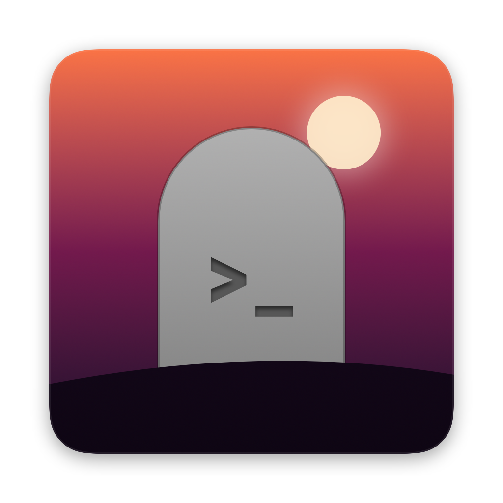

<p align="center">
  
</p>

<h1 align="center">Reaper</h1>

<p align="center"><strong>Reap the processes your coding agents leave behind.</strong></p>

Reaper is a native macOS menu bar app that finds the dev servers, watchers and daemons started by coding agents and lets you kill them in one click.

Agents spin up `npm run dev`, test servers and background daemons, then move on. Reaper shows every process an agent started: the command, the ports it holds and which agent started it. That includes **ghosts**, processes whose agent session has already ended.

## Supported agents

- Claude Code (CLI and desktop)
- Cursor (editor and `cursor-agent`)
- Codex (CLI and desktop app)
- OpenCode
- T3 Code

## Features

- **Grouped by agent:** each section shows the agent's own app icon.
- **Ghosts first:** within each agent, ghosts (👻) come first, then the longest-running processes.
- **Filters:** switch between *All* and *👻 Ghosts*, and optionally show only processes listening on a port.
- **CPU and memory:** each row shows what its process tree uses, measured the way Activity Monitor does. Expand a row for a per-process breakdown.
- **Ports:** click a port to open `http://localhost:<port>`. A 🌐 marks ports open on all network interfaces, not just localhost.
- **Kill:** × stops the whole process tree with SIGTERM, and offers *Force* (SIGKILL) if it survives. ⌥-click × to force-kill straight away. Expand a row to kill individual subprocesses.
- **Context menu:** copy the command or PID, or reveal the working directory in Finder.
- **Launch at login.**

## How it works

Reaper reads the process table with `libproc`, polls every 3 seconds, and doesn't shell out to `ps` or `lsof`.

- **Ancestry:** a process belongs to an agent when one of its parent processes is that agent.
- **Environment markers:** when the parent chain is broken because the process was reparented to `launchd`, Reaper falls back to markers that agents leave in the environment, such as `CLAUDECODE`, `CODEX_SHELL`, `CURSOR_AGENT` or the host app's bundle ID. Such a process is a ghost.
- **Noise filtering:** the agents' own helper processes, editor extensions (language servers, test workers) and updaters are hidden.

**Privacy:** Reaper only reads a fixed list of marker environment variables and never stores or shows any other environment values. It makes no network requests.

## Install

Download the latest build from the [releases](https://github.com/AppulseSoftware/reaper/releases), unzip it and move `Reaper.app` to `/Applications`.

Requires macOS 14 or later.

## Build from source

Requires Xcode 16 or later (Swift 6).

```bash
./bundle.sh              # ad-hoc signed build at build/Reaper.app
./bundle.sh --install    # build, copy to /Applications and launch
./bundle.sh --release    # universal, Developer ID signed and zipped for distribution
```

`--release` signs with the first `Developer ID Application` identity in your keychain; set `SIGN_IDENTITY` to choose another. To notarize as well, store credentials once and pass the profile name:

```bash
xcrun notarytool store-credentials reaper-notary --apple-id <apple-id> --team-id <team-id>
NOTARY_PROFILE=reaper-notary ./bundle.sh --release
```

To see what Reaper detects without the UI:

```bash
build/Reaper.app/Contents/MacOS/Reaper --dump
```

## License

Copyright 2026 Appulse Software B.V. Licensed under the [Apache License, Version 2.0](LICENSE).

---

<p align="center">Made by <a href="https://appulse.software">Appulse Software</a></p>
